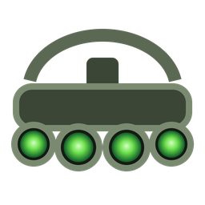
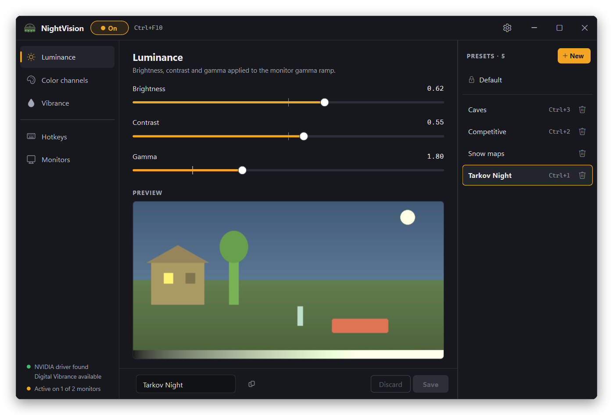
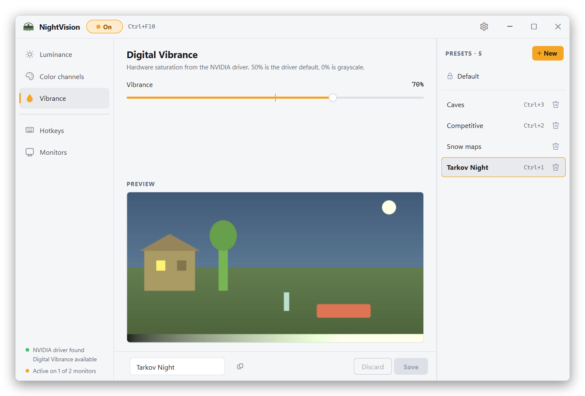
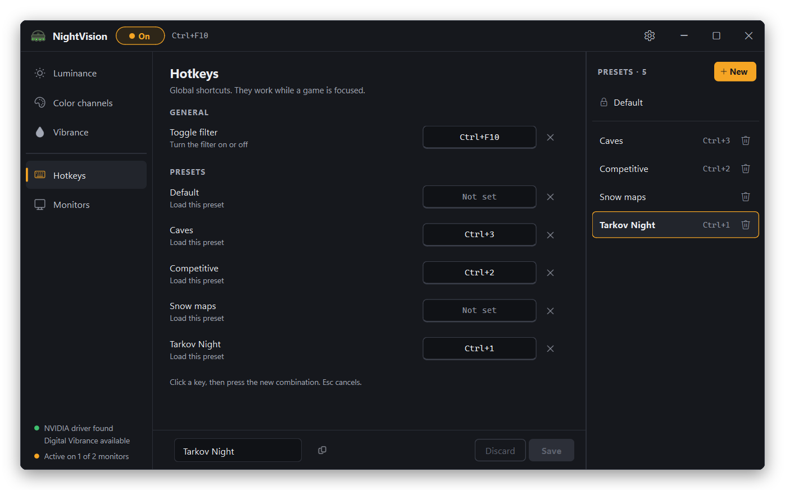
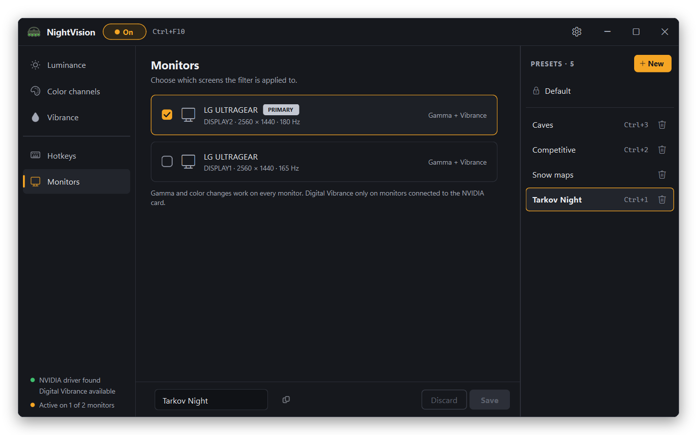
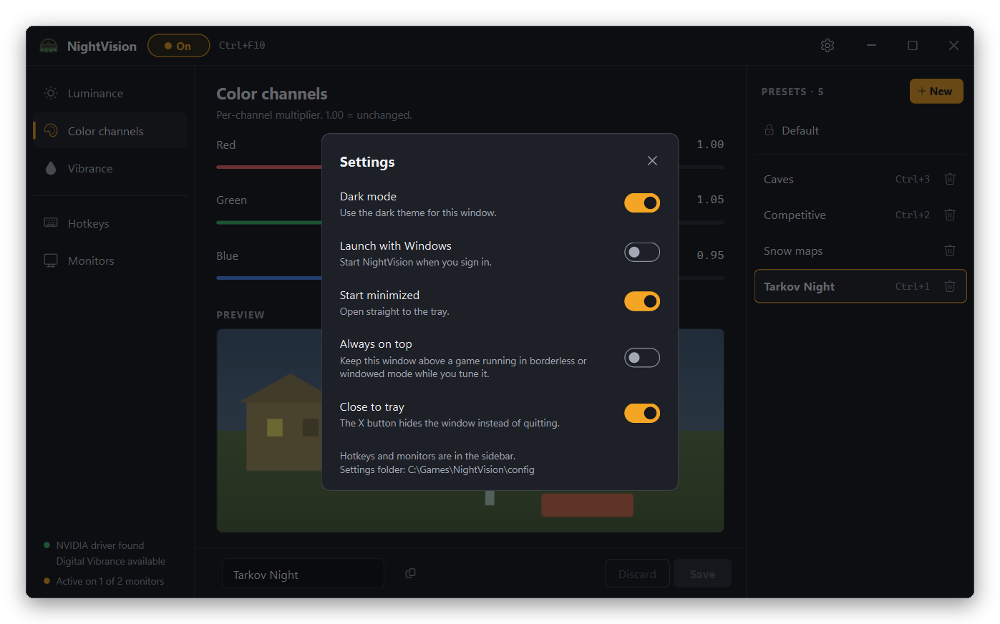
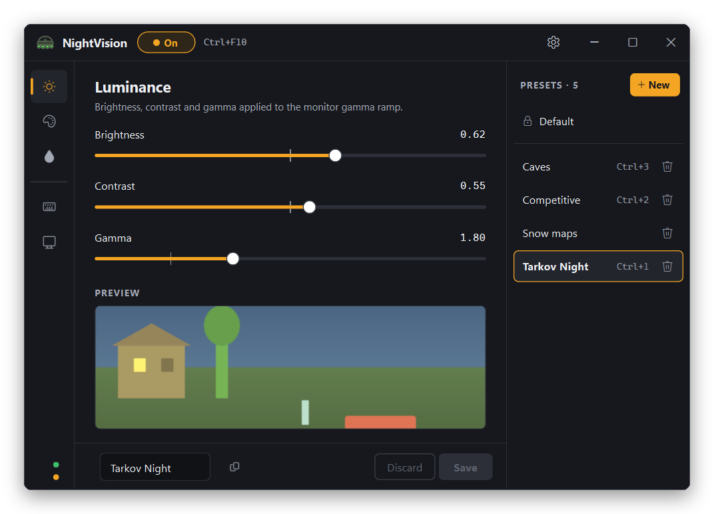

<p align="center">
  
</p>

<h1 align="center">NightVision Goggles</h1>

<p align="center">
  A Windows tray app that brightens dark scenes in games (made with Escape from Tarkov's nights in mind)<br>
  by changing the monitor's gamma ramp, with optional NVIDIA Digital Vibrance.
</p>

<p align="center">
  <a href="../../releases/latest"><b>Download the latest release</b></a>
</p>

<p align="center">
  
</p>

Based on [NightVisionFilterTool](https://github.com/zeroxpapone/NightVisionFilterTool) by **zeroxpapone**, released under GPL-3.0. This version adds a redesigned interface, Digital Vibrance, multi-monitor support and presets management.

## Requirements

* Made for **Windows 11** with an **NVIDIA** graphics card.
* Works on **AMD** and **Intel** GPUs too, but without Digital Vibrance (that part uses the NVIDIA driver); brightness, contrast, gamma and color channels work everywhere.
* Windows 10 should work, with square window corners.

## Features

* **Luminance**: brightness, contrast and gamma, applied through the Windows gamma ramp (works with NVIDIA, AMD and Intel GPUs).
* **Color channels**: per-channel red / green / blue multiplier.
* **Digital Vibrance (NVIDIA only)**: 0–100%, same scale as the NVIDIA Control Panel (50% is the driver default). Restored to its previous value when the filter is turned off.
* **Monitors**: apply the filter to one or more screens. Vibrance works on the monitors connected to the NVIDIA card.
* **Presets** in the right sidebar: **New** and **Duplicate** create a preset right away; slider changes stay "unsaved" until you press **Save** (or **Discard**). The **Default** preset (neutral values) is always first and can't be renamed or deleted.
* **Hotkeys**: one to toggle the filter (**Ctrl + F10** by default) and one per preset. They use the native Windows `RegisterHotKey` API, so they keep working after long idle periods. The registered combination is not forwarded to the game. Press Esc while recording to cancel.
* **Live preview** of the current values, dark and light theme, launch with Windows, start minimized, always on top, close to tray (gear icon).
* Native Windows 11 window behaviour: Snap, Snap Layouts, resizing and animations.

Check that the values suit your monitor before relying on them in a match: hop on an offline raid to try them out.

## Screenshots

<table>
  <tr>
    <td width="50%"><p align="center">Light theme · Digital Vibrance</p></td>
    <td width="50%"><p align="center">Global hotkeys for the toggle and every preset</p></td>
  </tr>
  <tr>
    <td width="50%"><p align="center">Apply the filter to one or more monitors</p></td>
    <td width="50%"><p align="center">Settings</p></td>
  </tr>
  <tr>
    <td colspan="2" align="center"><p align="center">Narrow window: the sidebar collapses to icons</p></td>
  </tr>
</table>

## Install / run

* **Download**: check the Releases page for the latest `NightVision.exe` (if available).
  The app itself is called NightVision: the executable is `NightVision.exe` and the window and tray show that name.
* **From source** (Python 3.12):
  ```
  python -m venv .venv
  .venv\Scripts\pip install -r requirements.txt
  .venv\Scripts\python launcher.py
  ```
* **Build the exe**: `.venv\Scripts\python build.py` → `dist\NightVision.exe`.

Settings and presets are stored in a `config` folder next to the executable (`settings.json`, `presets.json`), so the app is portable. If that folder is not writable (e.g. inside Program Files) they go to `%LOCALAPPDATA%\NightVision`. Settings from NVFT 2.x are imported on first start.

## Stream Deck / MacroButtons

Running the exe while NightVision is already open toggles the filter, the same way the hotkey does. So a Stream Deck button can simply run `NightVision.exe`, and in VoiceMeeter MacroButtons you can use `System.Execute("PATH TO NightVision.exe","","");`.

## Credits

* Original project: [NightVisionFilterTool](https://github.com/zeroxpapone/NightVisionFilterTool) by **zeroxpapone**
* NightVision Goggles: **S69xPistol**
* Contributor: **Claude** (Anthropic), who co-wrote the redesign and the new features; the app icon was also made with Claude

## License

Distributed under the **GNU General Public License v3.0**, like the original project. See `LICENSE` for more information.

**Disclaimer:** This software is provided **"as is"**, without warranty of any kind, express or implied. The authors are not responsible for any hardware damage, data loss, or **game account bans** resulting from the use of this tool. Use it at your own risk.
